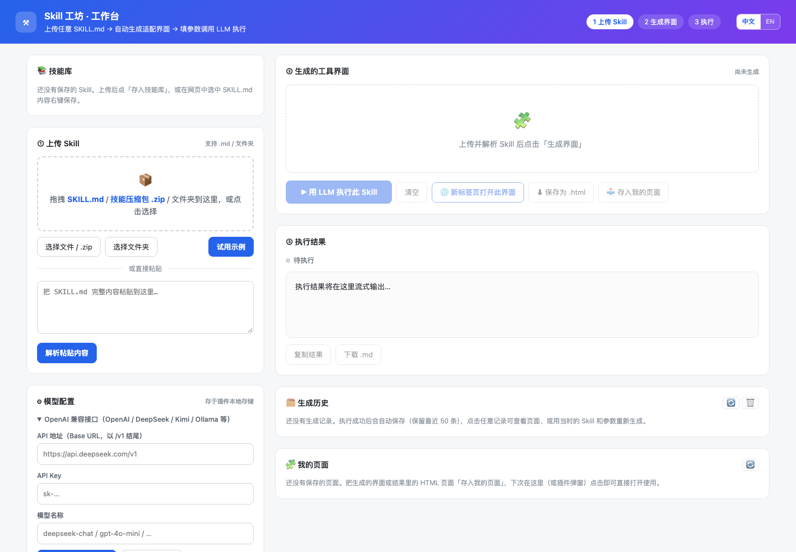
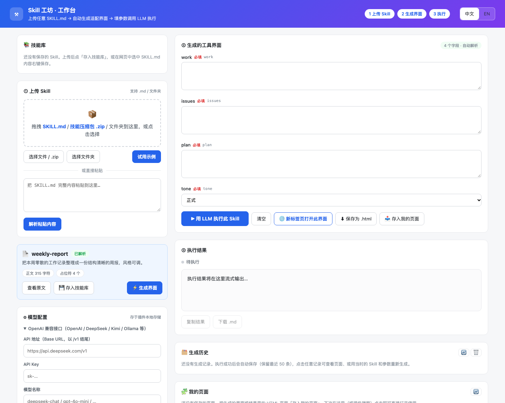

<div align="center">

# ⚒ Skill Forge · Skill 工坊

**Turn any SKILL.md into a working tool — right inside your browser.**
**上传一份 SKILL.md，自动生成可执行的工具界面，直接调用 LLM 干活。**

[](https://developer.chrome.com/docs/extensions/mv3/)
[](./LICENSE)
[]()
[]()
[]()

</div>

---

Skill Forge is a **Manifest V3 browser extension** (works on Chrome / Edge / any Chromium browser) that bridges the gap between **Agent Skills** and everyday tools:

1. **Load** a `SKILL.md` (file / folder / paste / `.zip` / right-click on any webpage)
2. **Generate** a matching UI for it — auto-parsed placeholders, AI-designed forms, or manual fields
3. **Run** the skill with any OpenAI-compatible LLM API, with streaming output
4. **Save** generated pages into the extension — one click to reopen and reuse, anytime

> No build step. No backend. No framework. Zero npm dependencies — everything runs locally in your browser, your API key never leaves your machine.

## ✨ Features

| | Feature | Description |
|---|---|---|
| 🧩 | **Skill Library** | Skills persist in `chrome.storage.local`; one-click reload from the workbench or the toolbar popup |
| ⚡ | **Adaptive UI Generation** | Three ways: placeholder auto-parse (no API key needed) · AI-designed forms (each skill gets its own interface) · manual fields |
| 📦 | **Skill ZIP Packages** | Drop a `.zip` — single-skill or multi-skill repos are parsed in-browser with a hand-written ZIP reader + native `DecompressionStream` (zero dependencies) |
| 🌐 | **Standalone HTML Export** | Any generated page can be opened in its own tab or downloaded as a **single-file HTML tool** that you can share with anyone |
| 🗂️ | **My Pages** | Save generated tool pages into the extension; click to reopen & use, rename, delete, up to 100 pages |
| 🕘 | **Run History** | Last 50 runs with skill badges and result viewer (Markdown / rendered HTML); re-run with one click |
| 🖱️ | **Context Menu** | Select text on any webpage → right-click to save it as a skill, or execute it with a chosen skill |
| 🌍 | **Bilingual (中文 / EN)** | Full UI translation on every surface, remembered across pages; exported HTML files carry i18n too |

## 🚀 Quick Start

### Option A — Browser Extension (recommended)

1. Clone / download this repo
2. Open `chrome://extensions`, enable **Developer mode**
3. Click **Load unpacked** → select the `extension/` folder
4. Pin the ⚒ icon to your toolbar

### Option B — Single-file Standalone

Open `skill-forge-standalone.html` in any browser. Double-click and go. (Data stored in `localStorage`; same core features as the extension.)

### First Run

1. Open the workbench → expand **Model Config**
2. Fill in any OpenAI-compatible endpoint, e.g.
   - DeepSeek: `https://api.deepseek.com/v1` + `deepseek-chat`
   - Local Ollama: `http://127.0.0.1:11434/v1`
3. Upload a SKILL.md (or hit **Try Demo**) → **Generate UI** → fill the form → **Run**

## 📸 Screenshots

| Workbench 工作台 | Generated Tool Page 生成工具页 |
|---|---|
|  |  |

## 🗂️ Project Layout

```
skill-forge/
├── extension/                  # Chrome MV3 extension (load unpacked)
│   ├── manifest.json           # MV3 config (incl. sandbox page)
│   ├── background.js           # context menus + workbench launcher
│   ├── popup.html/js           # toolbar popup (skills + pages shortcuts)
│   ├── app.html/js             # workbench (core UI)
│   ├── tool.html/css/js        # standalone tool page (tab open + export)
│   ├── doc.html/js             # result page previewer (sandboxed render)
│   ├── sandbox.html            # sandbox page for generated page scripts
│   └── i18n.js                 # zh/en dictionary + pattern rules
├── skill-forge-standalone.html # single-file standalone build
└── assets/                     # screenshots
```

## 🔐 Privacy & Permissions

- `storage` — skills, pages and config stored **locally only**
- `contextMenus` — right-click integration
- `host_permissions (http/https)` — the workbench calls **your** configured LLM API directly from your machine

**Your API key is stored in your browser's local storage and sent only to the endpoint you configure. No telemetry, no servers.**

## 🤝 Contributing

Issues and PRs are welcome. The codebase is dependency-free vanilla JS — start with `extension/app.js` if you want to hack on the core.

## 📄 License

[MIT](./LICENSE) © 2026 Skill Forge Contributors

---

<div align="center">Made with ⚒ by Skill Forge · If this helps you, give it a ⭐</div>
